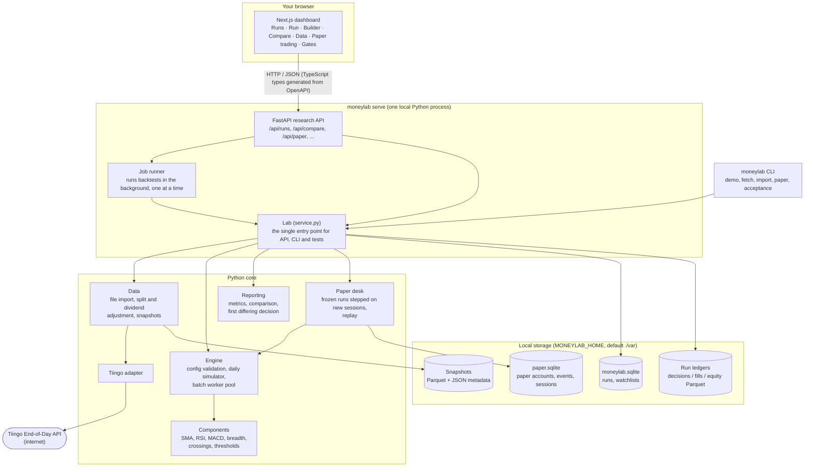
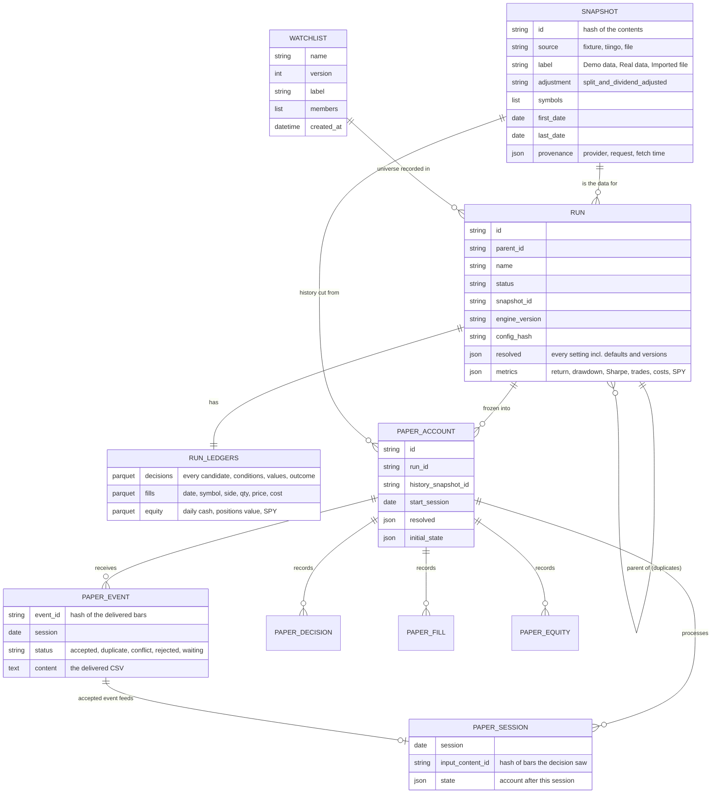
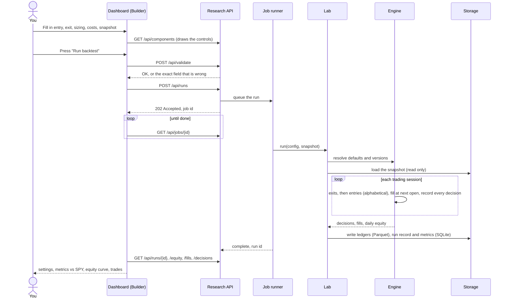
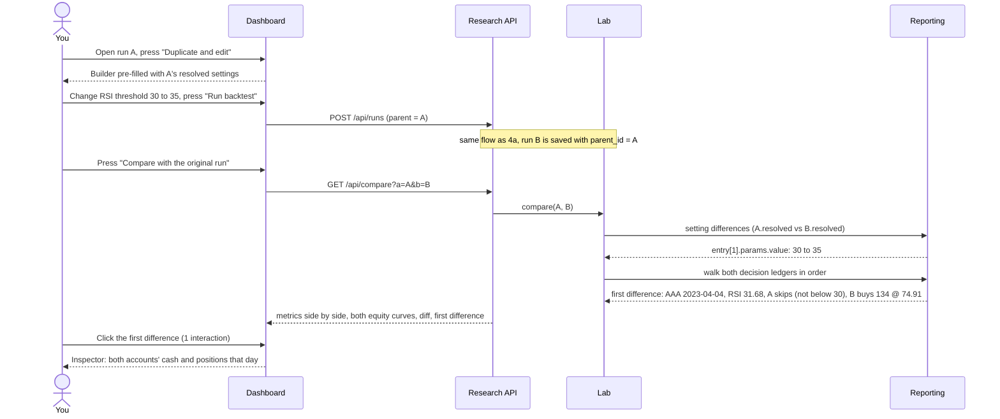
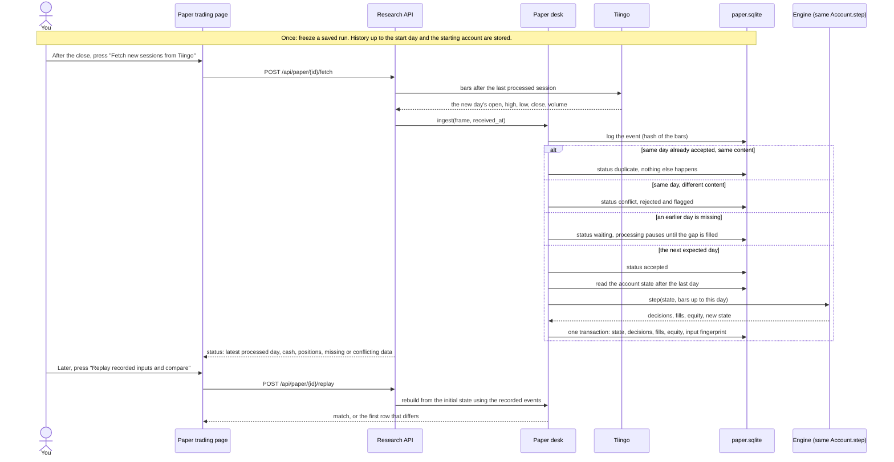
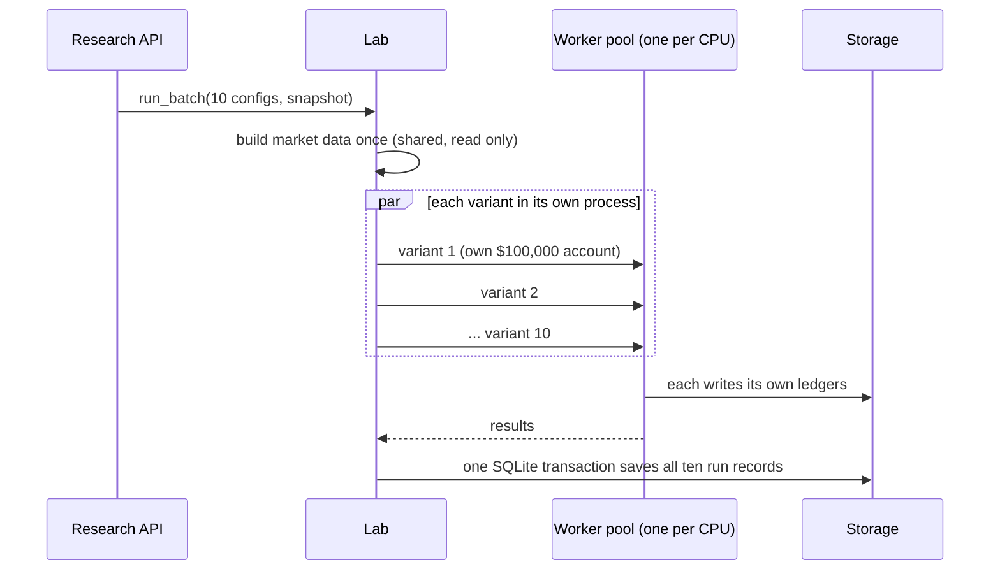

# Money-lab: where it stands (system overview)

Written 2026-11-25, describing `main` at `3e3db45` (after PRs #9 to #14). This is a plain
language tour: what the lab does, how the pieces fit, how far it is against the MVP spec,
what it cannot do yet, and the options for what to do next.

## The short version

- **What it is.** A research lab that runs on your own computer. You describe a trading
  rule for US stocks in a web dashboard ("buy when the close crosses above its 20-day
  average and RSI is below 30, sell after 10 days"), test it on years of daily prices,
  compare variants side by side, and see exactly which trade changed and why. You can also
  freeze a strategy and let it "paper trade" on new market days as they happen.
- **How far along.** Five of the six acceptance gates in the spec pass. Gate 4 is waiting
  for one thing only: a real, new market session processed live in paper mode. That is
  being done tonight (2026-11-25) in a separate thread.
- **What we learned from the first real question.** Buying one of SPY's 20 biggest stocks
  when RSI drops below 30 made 25.3% over 2018 to 2024, while simply holding SPY made
  143.9%. The lab answered the question correctly; the strategy loses mostly because it
  sits in cash 85% of the time. Since engine/0.4.0 idle cash can be held in SPY, and the
  rerun ([research/rsi30-idle-spy.md](research/rsi30-idle-spy.md)) finished at 161.1%, level
  with SPY, with no edge that is distinguishable from luck (t = 1.06).
- **Recommendation.** Finish gate 4 (in progress), then spend the next round on making the
  lab better at answering research questions (park idle cash in the benchmark, a research
  report page, point-in-time universes) rather than on more infrastructure.

## 1. What the system does, end to end

The spec's release demo is the best summary of the product. Here is each step and where it
lives today.

| Step in the spec | What you do | Where |
| --- | --- | --- |
| 1. Get data | Fetch real daily prices from Tiingo (or import a CSV). Every import becomes an immutable, labelled **snapshot**. | Dashboard **Data** page, `moneylab fetch` / `moneylab import` |
| 2. Build a strategy | Pick an entry rule (close crosses SMA20 from below), an exit (hold N sessions, or a signal), position size and costs. Controls are generated from the components' declarations. | **Builder** page |
| 3. Inspect and duplicate | Open the saved run, see every resolved setting (including defaults), press **Duplicate and edit**, add an RSI14 < 30 filter. | **Run** page, **Builder** |
| 4. Change one number | Duplicate again, change 30 to 35, run. The comparison shows the single setting difference and the first changed decision: symbol, date, observed RSI, both thresholds, action, and the effect on both accounts. | **Compare** page, decision inspector |
| 5. Run many variants | Submit a batch; each variant has its own $100,000 account; symbols in one account compete for its cash. | `POST /api/batches`, `Lab.run_batch` |
| 6. Paper trade | Freeze a saved run, feed it each new market day, and replay the record later to prove it is consistent. | **Paper trading** page, `moneylab paper ...` |
| (extra) Check the gates | See the status of all six acceptance gates. | **Gates** page, `moneylab acceptance` |

### The trading rules the engine follows

These are the "execution defaults" from the spec, all implemented:

- Every variant starts with **$100,000**, long only, whole shares, one position per symbol,
  **10% of equity per new position**, at most **10 positions**.
- Signals are checked **after the close**; the order fills at the **next session's open**.
- **5 basis points** (0.05%) cost on every buy and sell.
- Exits are processed before entries. When several stocks signal on the same day, they are
  taken in alphabetical order (a documented, deterministic tie-break).
- Cash can never go negative. If the stock opens higher and the order no longer fits in
  the cash, the whole order is **skipped** and the reason recorded
  (`insufficient_cash_at_open`). It never buys a smaller amount.
- Every candidate gets a recorded outcome: enter, exit, or skip with a reason
  (`max_positions`, `insufficient_cash`, `already_held`, `zero_quantity`,
  `insufficient_cash_at_open`), plus diagnostics for "not all conditions passed" and
  "not eligible" (warm-up or missing bar).
- The benchmark (SPY) is bought once with the same $100,000 and the same costs, and held.
- Lookbacks and holding periods count real NYSE trading sessions, not calendar days.

## 2. The pieces (architecture)

Everything runs locally as one app: `uv run moneylab serve` starts a Python server that
hosts both the research API and the dashboard at `http://127.0.0.1:8000`. The browser never
calculates a trade; every number comes from the Python engine.

What each piece is for, in plain words:

| Piece | Job | Key files |
| --- | --- | --- |
| **Dashboard** (Next.js, built as static files) | The screens you click through. It draws strategy controls from the list of components the server reports, so a new indicator shows up without UI changes. | `frontend/src/app/*` |
| **Research API** (FastAPI) | Turns clicks into calls on the lab and returns JSON. Long runs are queued as background jobs, so closing the tab does not stop them. | `src/moneylab/api/` |
| **Lab** | One front door for everything: the API, the command line and the tests all go through it. | `src/moneylab/service.py` |
| **Components** | Indicators and conditions. Each declares an id, version, parameters, defaults, limits and where it may be used. Adding MACD was one new file. | `src/moneylab/components/` |
| **Engine** | Checks a strategy is valid, fills in defaults, then steps an account one trading day at a time. Batches run on several CPU cores. | `src/moneylab/engine/` |
| **Reporting** | Metrics (return, drawdown, Sharpe, trades, exposure, costs) and the comparison that finds the first differing decision. | `src/moneylab/engine/reporting.py` |
| **Analytics** | The research layer computed after each run from its ledgers and the snapshot's bars, then stored: trade quality (win rate, payoff, expectancy, profit factor, t-statistic), edge per trade versus the benchmark, CAGR, Sortino, Calmar, drawdown length, beta and alpha, results by year, exit type, symbol and market regime, MAE/MFE, turnover and cost drag, the signal funnel, streaks and monthly returns. `moneylab recompute-metrics` redoes it for saved runs. | `src/moneylab/engine/analytics.py` |
| **Paper desk** | Takes a frozen strategy and processes new days as they are delivered, exactly once each, with replay. | `src/moneylab/paper/` |
| **Data** | Imports CSV or Tiingo data, adjusts for splits and dividends, and stores it as a snapshot whose id is a fingerprint of its contents. | `src/moneylab/data/` |
| **Storage** | SQLite for records, Parquet files for big tables. All local, no database server. | `var/` |

## 3. What is stored (data model)

Three ideas hold the data model together:

1. **Snapshots never change.** A snapshot's id is a hash of its contents. Corrected data
   gets a new id, so old runs keep pointing at exactly the data they used.
2. **A run stores what actually ran.** The run record keeps the fully resolved settings
   (including every default and component version) and the snapshot id, so reopening it
   later shows the truth even if defaults have since changed. A duplicate points to its
   parent.
3. **Paper trading records every delivery.** Every incoming day is logged, accepted at most
   once, and the account's state after each processed day is saved.

## 4. Key flows (sequence diagrams)

### 4a. Run a backtest from the dashboard

### 4b. Duplicate, change one setting, and compare

This is the core research loop and the subject of gates 3 and 6.

If nothing changed, the comparison says so explicitly. When a signal changes but a
portfolio limit blocked the trade, the decision row shows the skip reason.

### 4c. Paper trading: one new market day

### 4d. A batch of variants (gate 2)

Ten variants over 250 stocks plus SPY over five years finish in about 20 seconds on 4
cores (limit: 120 seconds), and running them one by one gives identical ledgers.

## 5. The six acceptance gates

| Gate | Status | What proves it (in plain words) |
| --- | --- | --- |
| 1. No-code configuration and extensibility | **Pass** | The RSI filter is added and changed entirely in the browser. MACD was added as one new file with no dashboard, engine or storage edits, and its controls appear, validate, save, and work in backtests and paper mode. |
| 2. Capacity and speed | **Pass** | 10 variants x 250 stocks + SPY x 5 years: three batches in 19.8 s, 21.0 s and 19.7 s (limit 120 s); about 11 to 12 s from pressing submit in the browser to seeing the comparison. Sequential and concurrent results identical. |
| 3. Research usability | **Pass** | From a saved run, change the universe and a threshold, run, compare, and the first changed trade and its reason are on screen. Zero interactions from the comparison to the first difference (gate allows two). The browser walkthrough took 18.9 s (gate allows 5 minutes). |
| 4. Correctness and forward replay | **Pending** | Hand-calculated fixtures (gaps, insufficient cash, simultaneous signals, costs, split, dividend) match to the cent. Paper mode over 19 delivered sessions equals the backtest; replay matches; restart and duplicate delivery add zero orders. **Missing:** one genuinely new market session processed live. Being done tonight in a separate thread. |
| 5. Universe and source flexibility | **Pass** | The same strategy runs on two watchlists with no code changes. Tiingo and CSV import give identical snapshots and identical ledgers. A live Tiingo check (AAPL split and dividend) passed on 2026-11-24. |
| 6. Historical inspection and reproducibility | **Pass** | Old runs show their original resolved settings after defaults change. An unchanged duplicate reproduces its ledger exactly. One edited threshold yields exactly one setting difference and the first decision difference. |

The spec's stop condition is "all six gates pass". After gate 4's live session, the MVP is
complete.

## 6. Done, partial and missing versus the spec

| Spec area | Status | Notes |
| --- | --- | --- |
| Universes up to 300 stocks/ETFs plus a benchmark | Done | Tested at 250 + SPY. |
| One live provider for history and new sessions | Done | Tiingo. Free tier is rate limited (see limitations). |
| Documented file-import format | Done | `docs/file-import-format.md`. |
| Immutable data versions, timestamps, adjustment policy | Done | Content-addressed snapshots with metadata and an import log. |
| Labelled user-selected watchlists | Done | Versioned; a run records the version and the date it was selected. |
| SMA, RSI, thresholds, above/below, crossings, "all must pass" | Done | |
| Holding-period exit, signal exit, breadth filter | Done | |
| Components declare id, version, parameters, limits, uses; UI generated from them | Done | MACD proves it. |
| Validation before execution | Done | Server checks; the builder shows the error before running. |
| Run history with resolved settings, versions, snapshot | Done | |
| Duplicate linked to parent, original preserved | Done | Refuses if a component version changed since. |
| Comparison: equity vs benchmark, return, drawdown, Sharpe (with assumptions), trades, exposure, costs | Done | |
| Config differences and first differing decision | Done | |
| Signal values, eligibility, orders, skip reasons, fills, cash, positions | Done | Decision inspector. |
| Concurrent variants with isolated accounts | Done | |
| Forward testing with the same engine, persisted across restarts | Done | |
| Latest processed session, missing and conflicting data shown | Done | |
| Reprocessing never duplicates an order or fill | Done | |
| One genuinely new live session in paper mode | **Partial** | Tonight. |
| Paper trading runs by itself each day | **Missing** | You (or a script) must press fetch each evening. The spec does not strictly require a scheduler; we cut the "forward recorder" on 2026-11-24. |
| Raw prices with split-adjusted share counts, integer-cent accounting | **Cut on purpose** | Decided 2026-11-24 (slim plan). Prices are adjusted at import; cash is kept to the cent with half-up rounding. |
| Checkpoints and crash recovery for long backtests | **Cut on purpose** | Backtests take seconds, so a crash just means re-running. Paper mode does survive crashes. |
| Forward-parity milestone (M4) | **Deferred** | Decided 2026-11-24. |

## 7. Known limitations

These are the things most likely to surprise you.

1. **Idle cash sits there unless you ask otherwise (engine/0.4.0).** By default, when no
   stock is signalling the money is in cash earning nothing, which is why the first RSI < 30
   run was only 15% invested and made 25.3% while SPY made 143.9%. The Builder's "Idle cash:
   hold SPY" setting parks it in whole SPY shares (sold at the open just before a buy that
   needs the cash; not counted as trades or positions). The default is unchanged so old runs
   still reproduce.
2. **Paper trading is manual and, right now, lives in the cloud.** Someone must fetch new
   sessions after each close. The gate 4 paper account was created in a cloud workspace
   that is temporary; to paper trade for weeks it should live on your Mac (or the
   fetch should be scheduled).
3. **Tiingo's free tier is tight.** It started refusing requests (HTTP 429) after about 60
   requests in one day. One request per symbol means a 250-stock universe cannot be
   fetched in one go on the free tier. The gate 2 speed test therefore used realistic
   synthetic data, not 250 real stocks.
4. **Universes suffer from hindsight unless you are careful.** The lab has no dated
   index-membership data. The research run used SPY's top 20 at the end of 2017 typed from
   memory, not from a dated holdings file.
5. **Price adjustment happens at import.** A dividend or split after a paper account starts
   re-adjusts history, which means starting a new run and a new paper account.
6. **Building blocks (updated 2026-11-25, engine/0.3.0).** Indicators: SMA, EMA, RSI, MACD,
   ATR, Bollinger %B, rate of change, N-day high/low, average volume, breadth. Conditions:
   thresholds, close crossing an indicator, and one indicator against another. Exits:
   hold N sessions, signal, stop-loss, take-profit, trailing stop, combined in a list.
   Sizing: percent of equity, fixed dollars, volatility (ATR). Entries can be ranked by an
   indicator. Still missing: short selling and "any of" entry rules. The dashboard does
   not show the new options yet (they are available through the API).
7. **Research statistics are in the dashboard (2026-11-26).** The report shows trade
   quality, versus SPY (edge per trade, t-statistic, beta, alpha), risk, results by year, exit
   type, symbol and market regime, monthly returns and a rolling one-year chart; Compare
   shows the key rows with B - A. Still missing: out-of-sample / walk-forward checks,
   parameter-neighbourhood views, and the same metrics on paper accounts. Runs saved before
   this are filled in the first time they are opened (or with `moneylab recompute-metrics`),
   provided their snapshot file is still present. Intraday runs use sessions = bars.
8. **Background jobs are in memory.** A run that was queued when the server stopped is
   lost (finished runs are safe). Runs execute one at a time; batches use all cores.
9. **Single user, local only, daily bars only.** By design for the MVP.

## 8. What the first research question showed

Full note: [research/rsi30-spy-top20.md](research/rsi30-spy-top20.md).

| Variant | Total return | Sharpe | Max drawdown | Avg invested | Round trips |
| --- | --- | --- | --- | --- | --- |
| RSI < 30, hold 10 | 25.3% | 0.32 | -27.8% | 15% | 258 |
| RSI < 35, hold 10 | 66.6% | 0.58 | -25.3% | 29% | 513 |
| RSI < 25, hold 10 | 0.4% | 0.05 | -22.3% | 6% | 99 |
| Hold SPY | 143.9% | 0.75 | -33.7% | 100% | |

Each trade beat SPY over the same 10 days by 0.42 percentage points on average, but that is
not statistically reliable (t = 1.24) and flips sign in 2020 and 2023. Rerun with idle cash
in SPY (engine/0.4.0), the base variant made 161.1% against 143.9% for SPY (14.7% a year
against 13.6%), beta 1.03, alpha +0.7% a year, edge t = 1.06: level with SPY, no proven edge
([note](research/rsi30-idle-spy.md)). The takeaway is less
"RSI does not work" and more "a strategy that is 85% cash cannot be compared fairly with
being 100% in the market". The lab did its job: it produced a clear, reproducible, honest
answer.

## 9. Options for moving forward

Ordered by how much they help you answer real research questions per unit of effort.

| # | Option | What you get | Effort | Why now or later |
| --- | --- | --- | --- | --- |
| 1 | **Finish gate 4** (in progress tonight) | All six gates pass; the MVP is officially done. | Small | Already running. |
| 2 | **Park idle cash in the benchmark (done, engine/0.4.0)** | A setting: "hold SPY with cash not in positions". Turns the research question into a fair fight: does switching into oversold stocks beat holding SPY? | Medium (engine + reporting + UI toggle; tests by hand-calculation like the others) | Directly fixes the biggest research gap. Must come with a new engine version so old runs still reproduce. |
| 3 | **Research report on the Compare page (done)** | Trade-level edge vs SPY, t-statistic, win rate, by-year and by-symbol tables, in the dashboard instead of a script. | Small to medium | Makes every future question faster to judge. |
| 4 | **Paper trading on your Mac, on a schedule** | A daily after-close job that fetches and processes the new session, and a status you can glance at. | Small to medium | Needed if you want weeks of forward evidence; not needed for the gates. |
| 5 | **Point-in-time universes** | Import dated index or ETF holdings so a backtest only trades what was actually in the index then. | Medium (data source is the hard part) | Removes hindsight bias from every "top N" study. |
| 6 | **More building blocks** | Stop-loss and trailing stop exits, volatility-based sizing, "rank by indicator and take the best N", Bollinger or ATR. Each is one new component file thanks to gate 1. | Small each | Pick based on the next question you want to ask. |
| 7 | **Data capacity** | Tiingo paid tier or a bulk cache so 250 real stocks can be fetched. | Small (mostly a decision and a key) | Only matters when you want large real universes. |
| 8 | **Robustness tooling** | Walk-forward / out-of-sample splits, parameter sweeps over a grid. | Medium to large | The spec excludes automated optimisation; this is a scope change. |

### Recommendation

1. **Let gate 4 finish tonight.** That closes the MVP against the spec.
2. **Next round: options 2 and 3 together**, as one small milestone ("fair comparison").
   Rerun the RSI study with idle cash in SPY and the new report. That tells you, with
   numbers, whether this line of research is worth more time.
3. **Then option 4** if the answer is promising, so a candidate strategy starts building a
   real forward record on your Mac.
4. Leave options 5 to 8 until a specific research question needs them.

Each step keeps the lab's existing guarantees: the same engine for backtest and paper mode,
immutable data, and old runs that still reproduce exactly.
